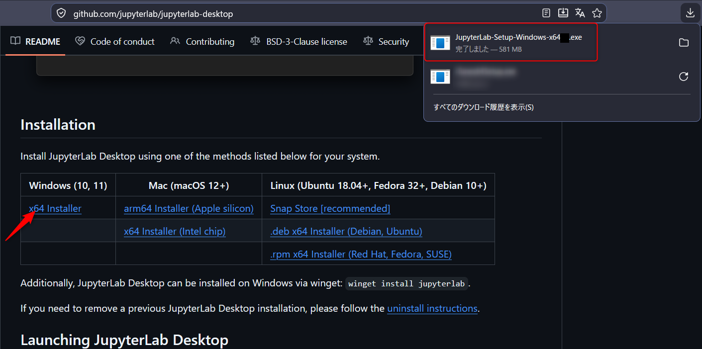
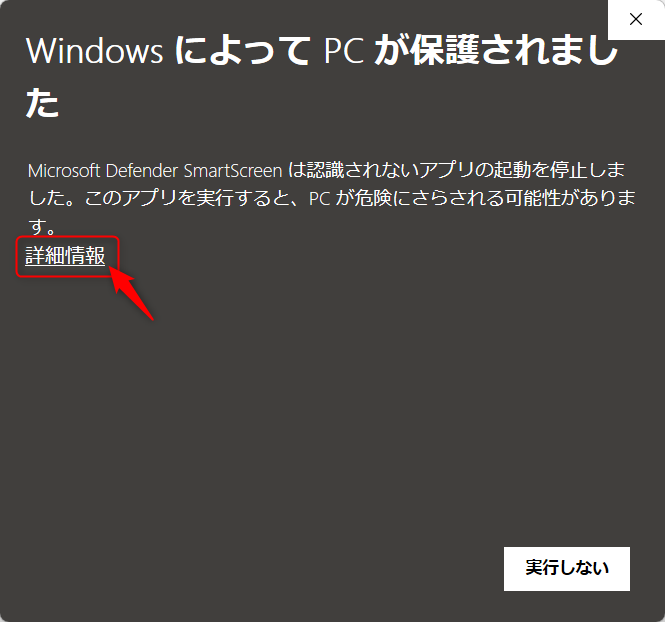
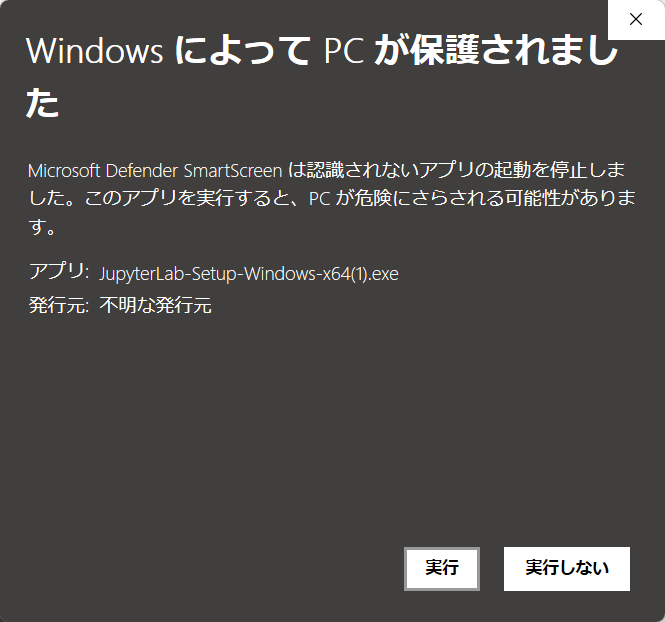
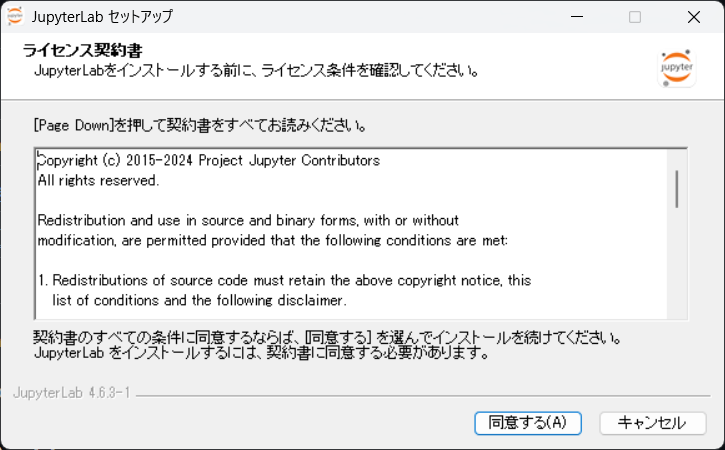
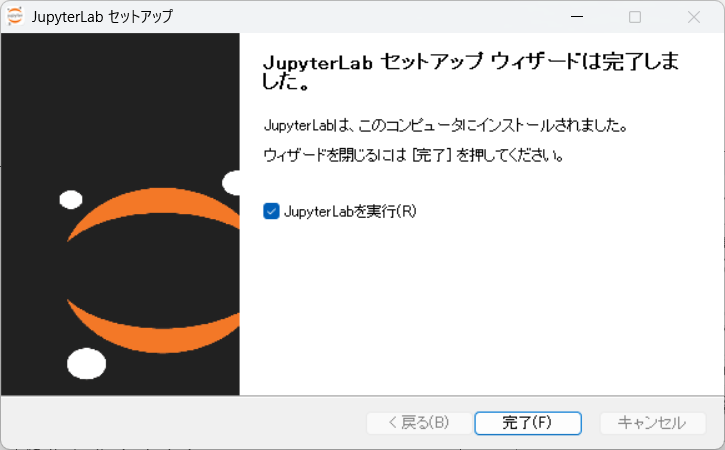
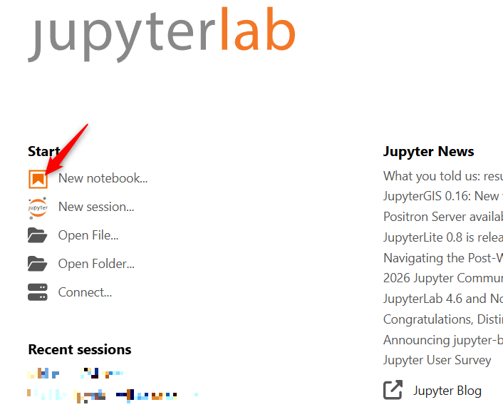

# JupyterLab-Desktop のインストール方法について

2026年10月29日

Windows版

下のリンク先をブラウザで開き，矢印の先で示した，「Download」の「Windows Installer」から実行ファイルをダウンロードして下さい。

(Windows版)[https://github.com/jupyterlab/jupyterlab-desktop#installation]



ダウンロードしたファイルを実行して下さい。警告が出ますので「詳細情報」，「実行」を押下してください。









インストールが終わったら，起動してみましょう。Startの下の New Notebook... を押下してください。



枠の中に文字を入力してください。

```
print("Hello World!")
```


